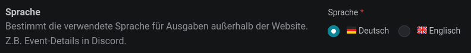
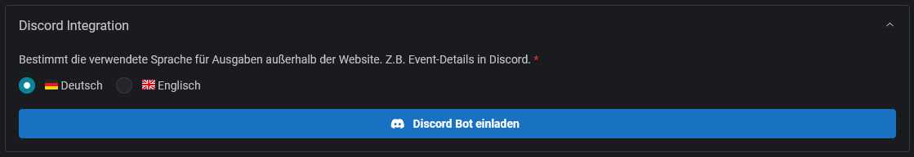
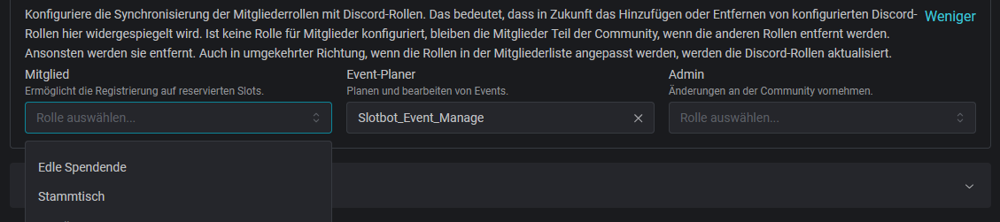
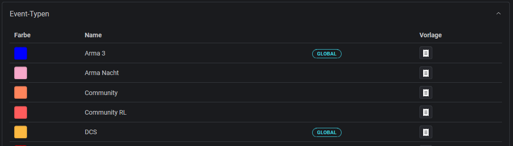

<Info>
	**Permissions**

    The `Admin` role is required for configuring a community.

</Info>

## Discord Integration

### Language

Not all integrations allow the user to choose their preferred language. With Slotbot, a language can be set for static texts such as the details of an event in Discord.

The following settings can only be configured once the bot has joined the server.

### Archive Channel

Information about an event can be saved in an archive channel once it has finished.

<Card
  title={"Archive"}
  href={"/en/integrations/discord/archive"}
  horizontal
  arrow
/>

### Member Roles Synchronisation

The three authorisation roles can be linked to Discord roles. When a new role is assigned to a person, the corresponding Discord role is assigned automatically. The reverse also applies: if the linked Discord role is assigned, the corresponding authorisation role is automatically updated.

<Info>
  Because of Discord role hierarchy only roles below the "Slotbot integration
  role" can be selected. You can adjust the order of the roles in Discord in the
  Server Settings menu under 'Roles'.
</Info>

<Tip>
  Tip: If you configure Discord roles, also configure them for the [slash
  commands](/en/integrations/discord/recommended-configuration).
</Tip>

## Event types

All available event types are listed here. Event types marked as "Global" are pre-defined standards. All others are private to your community.

Templates can be configured for all types. Learn more about it here:

<Card
  title={"Event Standards"}
  href={"/en/communities/event-standards"}
  icon={"receipt"}
  horizontal
  arrow
/>
