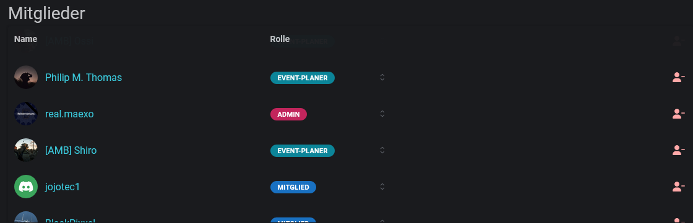

Members are the integral part of communities. Only people listed there are allowed to register for [reserved slots](/en/events/creating-events/slotlist-rules#reservation).

<Info>
	**Permissions**

    The `Admin` role is required for managing the members of a community.

</Info>

New players can be added by [synchronising the member roles](/en/communities/configuration#synchronisation-of-member-roles), or by using the [add community](/en/integrations/discord/bot-commands/add-community) command.
