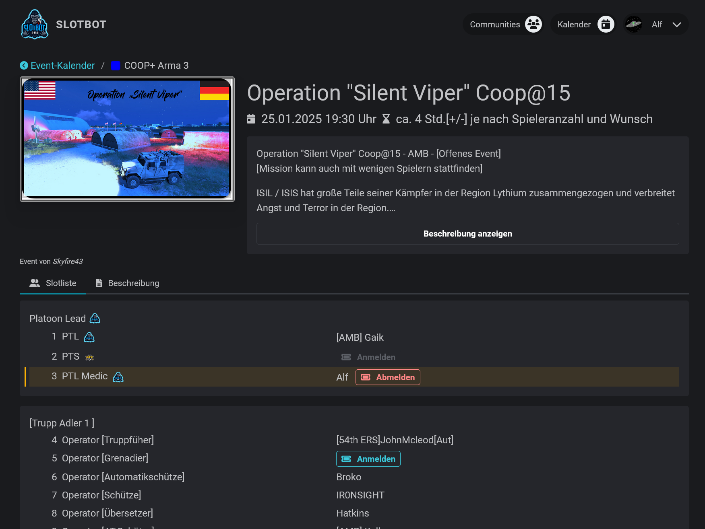

It doesn't matter whether you're planning private and spontaneous get-togethers or organizing cross-community large-scale events, Slotbot makes it easy for you and everyone to stay on the same page.

<Frame caption={"An event from your calendar"}>
  
</Frame>

All information is accessible for everyone, everywhere, without the need for manually sent PDFs or shared Excel lists anymore.

<Frame caption="Signing up for an event over Discord">
  
</Frame>

Everything is mirrored directly in your own Discord servers. Participants can easily register and deregister using text commands without having to leave the app.

<Card
  title={"Get started"}
  icon={"rocket"}
  href={"/jetzt-starten"}
  horizontal
  arrow
/>

Or take a look in other communities' calendars: [slotbot.de](https://slotbot.de)
